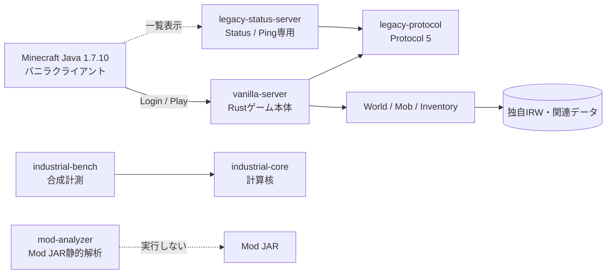

# IndustrialRust1710

**Minecraft Java Edition 1.7.10 / Protocol 5向けの、Rustネイティブサーバー開発プロジェクト**です。

> **開発途中です。** 現在のRust実装と「無改造のMinecraft 1.7.10で完全に遊べること」は同義ではありません。機能ごとにコード・CI・実クライアント検証を分けて確認してください。Forge/FML Modの実行・互換機能は現時点の主対象ではありません。

## 開発言語の方針（必須）

**サーバー本体・ゲームロジック・通信・保存・管理GUI・本番運用機能の実装は Rust のみ**です。Python は独立した検証・テスト・負荷試験・回帰確認用のプログラムに限ります。新しいPython製の本体機能や管理・監督処理は追加しません。シェル/PowerShellは必要最小限の環境準備・起動に限定します。

既存のPython製メンテナンス監督・GitHubブランチ整理ツール、C#製Windows管理GUIは、機能を壊さずRustへ移行する既存課題です（[追跡Issue #635](https://github.com/RyuuzinnRaika/IndustrialRust1710/issues/635)）。現時点では**すべての周辺機能がRust化済みという意味ではありません**。開発者・自動実装担当向けの詳細ルールは [AGENTS.md](AGENTS.md) を参照してください。

**図解で全体を把握する:** [アーキテクチャ・通信・Tick・保存・移行・CI（Mermaid 6テーマ）](docs/00_プロジェクト図解.md)

**GitHub Actionsを使わず自宅のUbuntuサーバでRust検証:** [ローカルCargo CIの実行・systemd毎時検証・ログ確認](docs/local-rust-ci-no-actions.md)。公開PRを自動実行する仕組みではなく、信頼した`main`だけを独立環境で検査します。

## まず全体を知る



**大切な区別:** `legacy-status-server` はゲーム参加用のサーバーではなく、`mod-analyzer` はMod実行環境ではありません。また、Anvil/NBTの読み書きが部分的に存在しても、既存バニラワールドの完全な移行が保証されたわけではありません。

## 使い方

Rustのstableツールチェーンを用意します。次の例は開発・検証向けで、公開運用の設定ではありません。

**Windows (PowerShell)**

```powershell
git clone https://github.com/RyuuzinnRaika/IndustrialRust1710.git
cd IndustrialRust1710
Copy-Item config/whitelist.example.json whitelist.json
notepad whitelist.json
cargo run --release -p vanilla-server -- --bind 127.0.0.1:25565 --whitelist ./whitelist.json
```

**Linux / macOS**

```bash
git clone https://github.com/RyuuzinnRaika/IndustrialRust1710.git
cd IndustrialRust1710
cp config/whitelist.example.json whitelist.json
# whitelist.json に参加するユーザー名を設定
cargo run --release -p vanilla-server -- --bind 127.0.0.1:25565 --whitelist ./whitelist.json
```

対応クライアントは **Minecraft Java Edition 1.7.10**。既定はローカルループバックを前提とした開発構成です。ユーザー名ホワイトリスト単独では本人確認になりません。`online-mode` のコードが存在しても、設定・受け入れ試験を確認するまではインターネットへ公開しないでください。

## 主なコンポーネント

| パッケージ | 役割 | 留意点 |
| --- | --- | --- |
| `apps/vanilla-server` | Protocol 5のLogin/Play、ゲームロジック、セッション、保存 | Rustネイティブの開発中サーバー |
| `crates/legacy-protocol` | Protocol 5のフレーム・エンコード基盤 | 全Minecraft機能をこのcrateだけで実装するわけではない |
| `apps/legacy-status-server` | Status / Ping | Login/Playは`vanilla-server` |
| `crates/mod-analyzer` | Mod JAR・Modpackの静的解析 | Forge/Modは実行しない |
| `crates/industrial-core` | Tick・工業ネットワーク計算の核 | ゲーム本体とは別の研究基盤 |
| `apps/industrial-bench` | 合成負荷のベンチマーク | 実サーバーのTPS測定ではない |

## バイオーム付き地形をWindowsで起動（A01）

`run-windows.ps1` を**引数なし**で実行すると、Minecraft Java 1.7.10向けのIRW4地形生成器（固定シード42）が有効になり、平原・森林・海洋・川・起伏・洞窟・鉱石・村などを生成する**別のワールド** `world/biomes-42.irw` を作成／再読込します。最初はサバイバルモードです。IRW4の地形生成は独自実装であり、本家1.7.10と完全一致するわけではありません。

```powershell
.\run-windows.ps1
```

### Windows版のサーバー管理GUI（Minecraft 1.7.10風）

Windows の通常の対話型ターミナルから `.\run-windows.ps1` を起動すると、ビルド確認後に本家サーバーの管理ウィンドウに似た画面を表示します。**Stats** はサーバープロセスのメモリ使用量（ワーキングセット）の推移、CPU使用率、スレッド数を、**Players** はログイン・ログアウトの通知から作ったオンライン一覧を、**Log and chat** はサーバー出力とコマンド入力欄を表示します。平均tick時間はサーバー側に測定値を公開するAPIがまだないため、`not available` と表示します。グラフは JVM heap ではなく OS のプロセスメモリです。

コマンド欄には `list`、`save`、`stop` などを入力できます。GUIから送信すると Rust サーバー側で必要な `/` を自動付与します。「Stop」ボタンまたはウィンドウを閉じる操作は `/stop` を送信し、ワールド保存とプレイヤー切断を待ちます。画面はローカルに表示されるだけで、外部公開する管理ポートは追加しません。

従来どおり**コンソールだけで起動**したい場合、または自動化・ログ収集・SSH等の場合は次を使用してください（`--nogui` も指定可能です）。

```powershell
.\run-windows.ps1 -NoGui
```

出力のリダイレクト時や `--verify-world` などのメンテナンスモードは自動的にGUIを起動しません。Windows PowerShell 5.1 のSTA環境を想定しています。実機のGUI動作はWindowsで確認してください。

従来の `world/flat.irw` は**自動変換・削除されません**。既存データを続けて利用する場合は、明示的に従来の保存先を指定してください。

```powershell
.\run-windows.ps1 --world world/flat.irw
```

シードや保存先を指定した別ワールドを作る場合は明示的に指定できます（既存保存先を上書きしません）。

```powershell
.\run-windows.ps1 --survival --expanded-seed 12345 --world world/biomes-12345.irw
```

`--expanded-seed` の初回起動は新しい保存先を使ってください。既存IRW1の平坦ワールドは、起動フラグを変えるだけで地形が切り替わることはありません。既存ワールドを必ずバックアップしてから試してください。起動・CIのテスト結果と無改造クライアントでの目視検証は別々に確認してください。

### 移動中の切断・MINECART CHECKPOINT ERROR（Windows）

`MINECART CHECKPOINT ERROR: expected 2 to 4 transaction participants` は、**旧版のバイナリ／ソース**でトロッコの定期保存（1ファイル）を古いジャーナル制限（2〜4ファイル）に通した時のエラーです。最新版の `journal.rs` は **1〜8ファイル**に対応しています。サバイバルモードやC04/C06移動の問題と混同せず、まず実行ソースを確認してください。

**サーバーを正常に停止**し、リポジトリのルートの PowerShell で実行します。

```powershell
git switch main
git pull --ff-only origin main
git rev-parse --short HEAD
Select-String -Path .\apps\vanilla-server\src\journal.rs -Pattern 'expected 1 to 8 transaction participants'
cargo clean -p vanilla-server
.\run-windows.ps1 -NoGui
```

`Select-String` に `expected 1 to 8 transaction participants` が出なければ、実行しているディレクトリが違うか、Git の更新に失敗しています。エラーが残る場合は `git rev-parse HEAD` と最初のエラーメッセージ全文を記録してください。**ワールド、`.minecarts.json`、`.pending-txn.json` を削除しないでください**。未完了のジャーナルはサーバー起動時にリプレイする設計です。

最新版には、実サーバーを起動し、20ティック後のトロッコ保存ファイル作成と、その後のサバイバル移動・再接続を確認する TCP 回帰テストが含まれます（`native_1710_minecart_checkpoint_keeps_survival_session_and_movement_alive`）。それでも切断される場合は、無改造1.7.10実機のサーバーログとクライアントログの両方で原因を切り分けます。

## 複数ディメンションの起動（A10・試験機能）

IRW4の3ディメンションを1つのワールドルートにまとめて管理する場合は、`--expanded-seed` と `--dimension-root` を併用します。

```bash
cargo run -p vanilla-server -- --survival --expanded-seed 42 --dimension-root ./worlds/demo --dimension overworld
```

- `./worlds/demo/overworld.irw`、`DIM-1/nether.irw`、`DIM1/end.irw` を同じシードで事前検査し、未作成の次元のみ生成します。
- 3つのワールドは独立した共有ハンドルで維持され、ルートの `session.lock` が各次元の書き込みを保護します。停止時には全次元のIRW4スナップショットをredo journal経由でまとめて保存します。
- `--dimension` で指定した1つの次元だけが、現段階のネットワークゲームセッションとTickの対象です。**プレイヤーがポータルに入って次元を切り替える処理は、まだ動作しません。** 同じワールドルートで複数プロセスを同時起動することもできません。
- `--dimension-root` は従来の `--world` とは併用不可です。既存のIRW1～IRW3やバニラのAnvilワールドには使用せず、開発用の新しいディレクトリに設定してください。

## 保存形式と開発上の安全性

- ライブゲームには独自の`IRW1〜IRW4`系ワールド保存と、プレイヤー・各装置等の個別データファイルを使います。
- 対応する複数ファイル更新にredo journalがありますが、**全保存経路の完全な原子性を意味しません**。
- Anvil / NBTとの相互運用・本家形式への切替は段階的な作業です。**元のバニラ/Forgeワールドを直接上書きしない**でください。
- 機能の実装と、無改造1.7.10クライアントによる実証試験は、別の合格条件です。

## ビルドと検証

```bash
cargo fmt --all -- --check
cargo test --workspace --all-targets
cargo clippy --workspace --all-targets -- -D warnings
cargo build --release -p vanilla-server -p legacy-status-server
```

GitHub ActionsのRust CIは書式・テスト・Lint・Releaseビルドを確認します。ただし、自動TCPテストの成功だけでは完全な1.7.10互換性を認定できません。

## ドキュメント案内

| 調べたいこと | 読む資料 |
| --- | --- |
| 全体の構成・処理のつながり | **[Mermaid図解ガイド](docs/00_プロジェクト図解.md)** |
| 目標とスコープ変更 | [要件定義](docs/01_要件定義.md) |
| バニラサーバーの詳細・段階実装 | [バニラ最小サーバー](docs/14_バニラ最小サーバー.md) |
| 保存形式を本家構造へ近づける順序 | [1.7.10セーブ互換と移行実装順](docs/17_1.7.10セーブ互換と移行実装順.md) |
| A〜Eの開発分担と未完了項目 | [50項目監査](docs/24_50項目実装監査と5人分担_20261021.md)、[100件バックログ](docs/25_修正すべき点100件_5人分担_20261021.md) |
| 停止・バックアップ・品質 | [J91〜J100](docs/J91-J100_運用品質実装状況.md) |
| **実行時の並列化・性能最適化** | **[実施した3件と追加8候補の監査](docs/29_並列最適化監査_20261023.md)** |
| **AI並列開発向け200項目の実装計画** | **[10グループ×20項目・担当ファイル・完了条件](docs/28_AI並列実装200項目_20261023.md)** |
| 詳細な変更履歴 | [CHANGELOG](CHANGELOG.md)、[従来READMEの記録（アーカイブ）](README_HISTORY_2026-10-20.md) |

> 古い設計書・監査表には、作成当時の「未実装」「PR待ち」の判定がそのまま残っています。**現在の状況はmain上の実コード、GitHub PR、CIおよび実機検証を優先**してください。

## ライセンスと注意

第三者ライブラリは [THIRD_PARTY_NOTICES.md](THIRD_PARTY_NOTICES.md) を参照してください。現在のソースツリーと過去のGit履歴のライセンス上の扱いは同一ではありません。歴史的なPumpkin由来コードの取込みについては [監査資料](docs/15_Pumpkin導入監査.md) に記録されています。Minecraft本体・Mod配布物・アセットはリポジトリへ追加しないでください。
