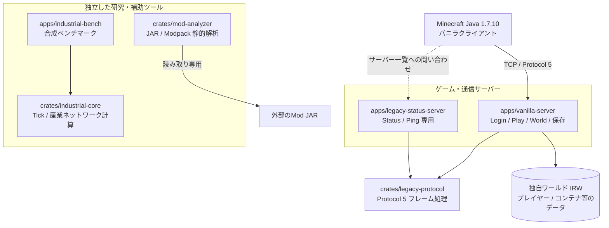
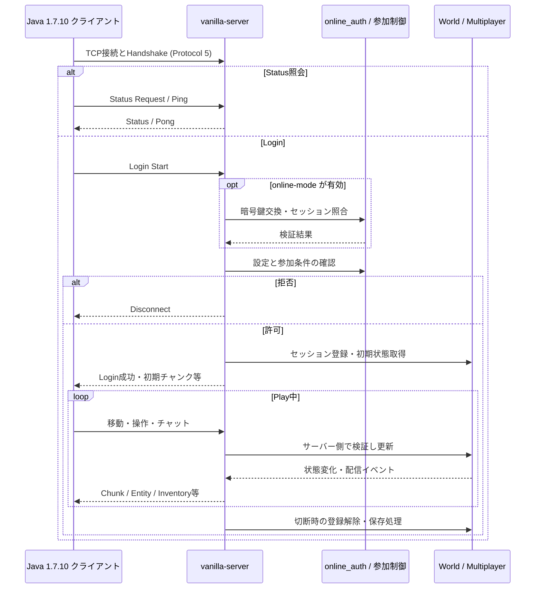
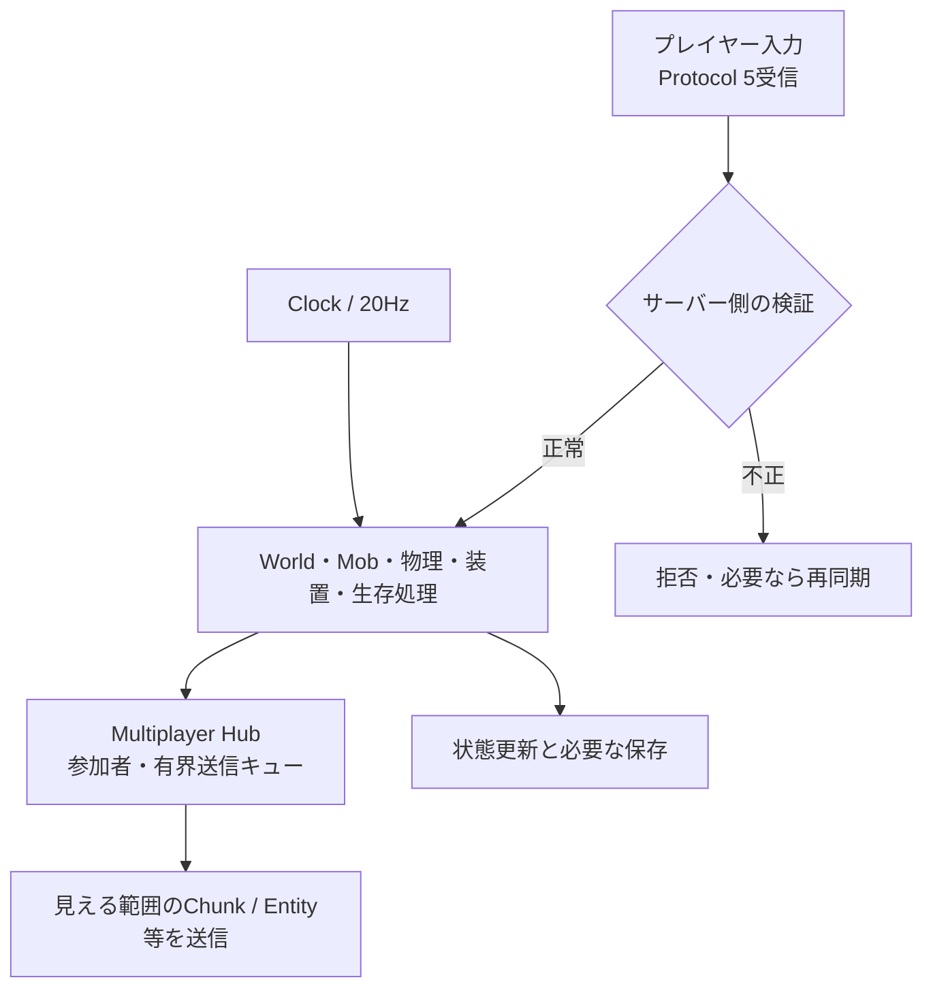
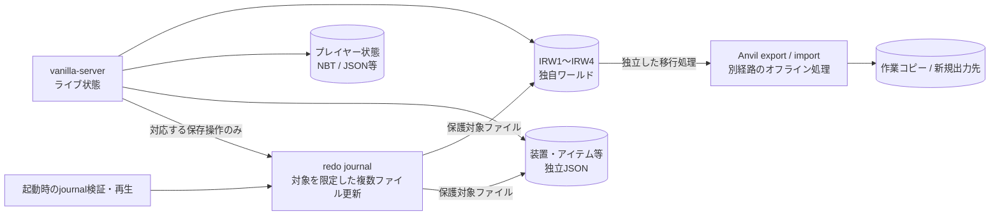
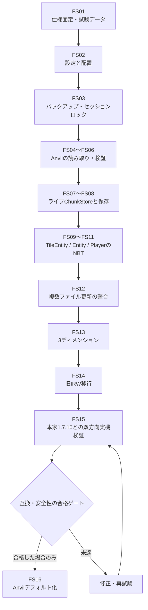
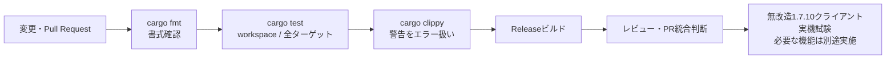

# IndustrialRust1710 プロジェクト図解ガイド

> 更新: 2026-10-23 / 対象: `main` の確認時点。**図はモジュールと設計上の責務を示す概念図**です。対応したコードがあることと、Minecraft 1.7.10 の実機互換試験に合格したことは別です。
>
> 実装状況はPR統合で変わります。旧README・過去の監査表の日時と、現行ソース・CI・実機試験結果を区別してください。

## 目次

1. [Cargo workspaceと各バイナリ](#1-cargo-workspaceと各バイナリ)
2. [Protocol 5の接続フロー](#2-protocol-5の接続フロー)
3. [20TPSのゲーム処理](#3-20tpsのゲーム処理)
4. [保存・復旧と安全境界](#4-保存復旧と安全境界)
5. [1.7.10保存形式への移行計画](#5-1710保存形式への移行計画)
6. [変更から検証まで](#6-変更から検証まで)
7. [担当分担とドキュメント](#7-担当分担とドキュメント)

## 1. Cargo workspaceと各バイナリ

`Cargo.toml` に列挙された6パッケージを中心にした配置です。**矢印は役割・データの流れ**であり、すべてが直接リンクされたcrate依存であることを意味しません。

- `vanilla-server` はRustネイティブのゲーム本体。`main.rs` と `world.rs`、`mobs.rs`、`inventory.rs` などのモジュールに処理が分かれています。
- `legacy-status-server` はStatus専用の**別バイナリ**です。通常のゲーム参加には `vanilla-server` を使用します。
- `mod-analyzer` は静的解析用で、**Forge/FML Modの実行環境ではありません**。
- `industrial-core` と `industrial-bench` はゲーム本体とは別の計算・計測経路です。

## 2. Protocol 5の接続フロー

StatusとLoginは別の要求経路です。`--online-mode` は追加の本人確認経路を使います。次は**概念的なフロー**で、エラー応答やパケット送信の細かい順番は省略しています。

**注意:** オンライン本人確認と、ホワイトリストによる許可判定は別です。設定と実装内容を確認せずサーバーをインターネット公開しないでください。

参照: `apps/vanilla-server/src/main.rs`、`online_auth.rs`、`whitelist.rs`、`multiplayer.rs`、`crates/legacy-protocol/`。

## 3. 20TPSのゲーム処理

Tickと接続セッションは同一処理ではありません。更新の責務を確認するための図で、実際のワーカースレッド数・ロック順序を規定するものではありません。

- `world.rs` の下位モジュール: `world/devices.rs`、`world/ecology.rs`、`world/lighting.rs`、`world/special.rs`。
- その他の主な処理: `mobs.rs`、`physics.rs`、`crafting.rs`、`furnaces.rs`、`hoppers.rs`、`minecarts.rs`。
- `multiplayer.rs` はプレイヤーを保持し、容量超過時に不整合なイベントを黙って欠落させない方針の有界キューを使います。
- **20TPSの時計が存在することは、すべての負荷条件で20TPSを維持できる証明ではありません。**

## 4. 保存・復旧と安全境界

現状のライブ処理は独自IRW形式を使用します。プレイヤー・コンテナ等の状態には別ファイルもあり、**すべての保存操作がひとつの原子トランザクションになったわけではありません**。

- `journal.rs` はファイル数とサイズを制限し、対象拡張子も限定してredoログを検証・再生します。**無関係な保存ファイルすべてを横断して整合させる仕組みではありません。**
- `anvil_export.rs` / `anvil_import.rs` / `legacy_*` は本家形式向けの変換・解析を段階的に進めるためのものです。ライブAnvil常時保存の完成を意味しません。
- 元のMinecraft 1.7.10 / Forgeワールドは**直接書き換えず、バックアップ後の作業コピーで検証**します。
- 異常終了・復元失敗・複数ファイル境界のリスクは、対応機能と受け入れ試験を分けて記録します。

## 5. 1.7.10保存形式への移行計画

以下は**実装済み一覧ではなく依存順**です。各ゲートを検証してから次工程に進みます。

詳細: [1.7.10セーブ互換と移行実装順](17_1.7.10セーブ互換と移行実装順.md)。

## 6. 変更から検証まで

`.github/workflows/ci.yml` のRust CIはfmt・test・clippy・release buildを実行します。**CIのTCPテスト合格は、実クライアントを操作した受け入れ試験の代わりにはなりません。** 配布用バイナリや再現ビルド検証は別ワークフロー・別要件です。

## 7. 担当分担とドキュメント

2026-10-21時点の[50項目監査・5人分担](24_50項目実装監査と5人分担_20261021.md)では、A=ワールド、B=ブロック、C=Mob、D=プレイヤー、E=通信・保存・品質という責務の分離が使われていました。これは**作業競合を避けるための過去の割当資料**で、現在の全PRや実装完了を保証するものではありません。

- [要件定義](01_要件定義.md) — 変更履歴を含むスコープの説明
- [バニラ最小サーバー](14_バニラ最小サーバー.md) — 過去の段階実装の詳細
- [保存形式・移行工程](17_1.7.10セーブ互換と移行実装順.md) — 安全なAnvil切替の依存順
- [50項目の監査](24_50項目実装監査と5人分担_20261021.md) / [100件バックログ](25_修正すべき点100件_5人分担_20261021.md) — **記載日時の監査スナップショット**
- [運用品質の状況](J91-J100_運用品質実装状況.md) — 個々の項目の受け入れ条件を区別して確認

**図を更新するときのルール:** ソースコードで確認できる事実、開発計画、未検証事項を同じ色や矢印で「実装済み」と表さない。モジュール名の変更時は図とリンクを一緒に修正する。
