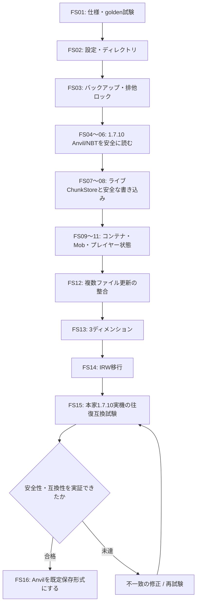

# 1.7.10本家サーバーの保存形式互換・実装順（2026-10-21）

## 移行依存関係（Mermaid）

> この図は**計画工程と合格ゲート**です。各FS番号を実装完了と読み替えないでください。作業の進捗や受け入れ試験の結果はPR・CI・実機検証で別途確認します。

概念的な保存経路・redo journalの適用範囲は [プロジェクト図解](00_プロジェクト図解.md#4-保存復旧と安全境界) を参照してください。

## 目標構造

MinecraftServer/{server.properties,whitelist.json,ops.json,banned-players.json,banned-ips.json,logs/,world/}。
world/{level.dat,level.dat_old,session.lock,region/r.X.Z.mca,playerdata/UUID.dat,data/,DIM-1/region/,DIM1/region/}。
必要になる項目のみ生成する。1.7.10と異なる現代のパレット式チャンクNBTやDataVersionに書き換えない。

## 現状と改修対象

| 現行コード | 現状 | 改修工程 |
|---|---|---|
| main.rs | CLI引数、旧IRW起動、ワールドTick/ネットワーク混在 | FS02、FS07〜08 |
| world.rs / terrain.rs / worldgen.rs | IRW1〜4の世界を疎なブロック編集で保存 | FS07、FS14 |
| anvil_export.rs / anvil_import.rs | 自前フラットワールド限定・オフラインスナップショット | FS04〜08 |
| player.rs / inventory.rs / experience.rs / vitals.rs | 一部NBTと複数独立JSON | FS11 |
| chests.rs / furnaces.rs / hoppers.rs / brewing.rs | 独立JSON保存 | FS09 |
| mobs.rs / ground_items.rs | 独立のMob/アイテム状態 | FS10 |
| journal.rs | JSON等最大3ファイル向けredoジャーナル | FS12 |
| dimensions.rs / worldgen.rs | 開発中のIRW4次元・地形基盤 | FS13 |

## 工程01：仕様固定と試験データ
1. fastnbt 2.6.3、fastanvil 0.32.0を起点に使う。Region APIの再利用と1.7.10専用チャンクNBTの実装を分離する。
2. 1.7.10本家でフラット・通常地形・負座標・チェスト/かまど/ホッパー・エンチャントアイテム・Mob・3ディメンション・2ユーザーの検証ワールドを作成する。合法的に取得し、GitにMinecraft配布物やプレイヤー個人データを同梱しない。
3. Rustから合成NBT/.mcaを生成してgolden testsに含め、Section Y、4096 Blocks、2048 Data、2048 Add、2048 BlockLight、2048 SkyLight、256 Biomes、HeightMap、Entities、TileEntities、playerdataのSlot、未知タグを検証する。
4. 異常系として不正NBT、解凍爆弾、重複セクタ、不正座標、セクションY重複、外部ファイルへのパストラバーサルを拒否する。
5. 本家データを意味保存できないときは読み取り専用または書込拒否。実機に対する検証とRust疑似クライアントのCIを別々に記録する。

## 工程02：設定と配置
- 現行の --world / --bind / --survival / --whitelist / --terrain-seed / --expanded-seed を保持し、**明示CLIが最優先**。
- server.propertiesはファイルがあるときにだけ解析。最初はserver-ip/server-port/level-name/gamemodeなど動作に結びつけられるキーに限定し、未対応の値を黙って反映したことにしない。
- 安全性：offline whitelist方式のため online-mode=true、white-list=false、enable-rcon=true、enable-query=true は原則拒否。外部IPへのbindは明示した --insecure-offline-lan が必要。
- level-nameは安全な単一フォルダ名でのみ許容。Anvil正式切替前のファイルは level-name/flat.irw という**独自形式**であり、level.datを読み書きできると誤認させない。

## 工程03〜16の依存順
- FS03のバックアップ・ロックをFS06〜08の書込より先に用意する。1.7.10のsession.lockはbig-endianの8バイトタイムスタンプで、別プロセス二重起動防止はOS側の追加排他機構も用意する。
- FS04〜06でAnvil read-onlyを完成させる。旧importで禁止していたEntities/TileEntitiesやBlocksのAddをまず**読込可能**にする。
- FS07〜08でメモリのWorldとディスクのChunkStoreを分離し、dirtyチャンクをまとめて永続化、リージョンをtemp+fsync+renameで更新する。
- FS09〜11で本家NBTへ状態を統合。未対応NBTタグを落とすなら書き戻しは不可。
- FS12でクロスファイル更新をジャーナル化して故障注入テスト、FS13で3ディメンション、FS14で旧IRWから移行。
- FS15の本家1.7.10とRustサーバーの双方向互換試験を全要件の最終ゲートにし、FS16のAnvilデフォルト化を認可する。
- 未完成の内容を完成として表示しない。各FSにPR番号、CI実行ID、未対応の受け入れ基準を記録する。

## 合格ゲート
全Rustフォーマット、全単体/実TCPテスト、Clippy警告ゼロ、Releaseビルド成功。既存IRW互換の回帰テスト成功。本家のユーザーワールドは**作業コピーでのみ検証**。
