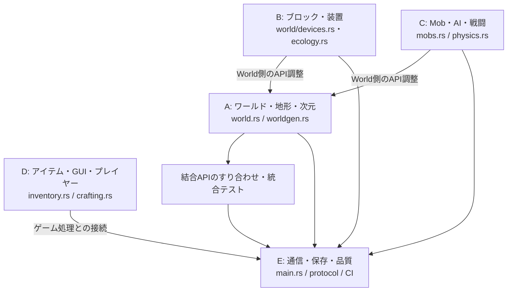

# 50項目 実装監査と5並列作業割当（2026-10-21）

## 5分担の依存関係（Mermaid）

> 2026-10-21の担当割当を**作業競合防止のために図示**しています。現在のPR担当者・マージ状況や各項目の完了を保証する図ではありません。

他担当の管理する`main.rs`や`world.rs`を直接競合修正するのではなく、必要な入出力・イベント・保存APIを担当者間で合意してから統合します。[現在の構成図](00_プロジェクト図解.md)も参照してください。

> 対象: IndustrialRust1710 / Minecraft Java 1.7.10 / Protocol 5 / Rustのみ。
> 基準: `main` = `d66b9b9c5b208d9a32b83eccfa7c502ddb0d1041`（[main CI SUCCESS](https://github.com/RyuuzinnRaika/IndustrialRust1710/actions/runs/39588082200)）。PR/ワークフローは並行更新されるため、統合直前に再照合する。
> 確認方法: `main` のファイル構成・要件文書、GitHub上のマージ済みPR・未マージPR 20件の本文、PRごとの変更パスおよび一部CIを確認。ローカルでのCargo実行とJava 1.7.10実機操作は**この監査では実施していない**。

## 判定ルール

- **本線一部**: `main` に動作の基礎が入っているが、要求の受入条件・バニラ互換・実機試験は未完了。
- **PR一部**: `main` の基礎の上に追加差分が未マージPRとして存在する。PRの実装は**本線への導入済みとは数えない**。
- **主要部未**: 項目の核となる機能が未実装。周辺データ型・アイテムID・読み取り器だけでは完成扱いしない。
- 50項目の**完全完了はこの監査では認定しない**。Rustのテスト合格は「無改造1.7.10クライアントで完全互換」を意味しない。

## A担当: ワールド・地形・ディメンション (01–10)

主な根拠: [PR #56（main統合済み）](https://github.com/RyuuzinnRaika/IndustrialRust1710/pull/56)、`worldgen.rs`、`dimensions.rs`。

| ID | 機能 | 判定 | 未完了・次の実装 |
|---|---|---|---|
| 01 | バイオーム拡充 | 本線一部 | 1.7.10の温度/降雨/植生/分布と境界互換 |
| 02 | 洞窟・渓谷 | 本線一部 | Vanilla相当の洞窟ネットワークと構造物競合 |
| 03 | 鉱石分布 | 本線一部 | 決定的近似を1.7.10の高度/鉱脈/試行回数で校正 |
| 04 | 河川・湖・海岸 | 本線一部 | 河川・砂浜・海岸の接続と配置互換 |
| 05 | 樹木・草花・植物生成 | 本線一部 | 樹種、植物群、生成率、更新との整合 |
| 06 | ダンジョン | 本線一部 | Mobスポナー実動作、戦利品・TileEntity保存 |
| 07 | 村・構造物 | 本線一部 | 村の整合と村人スポーン、設備/境界判定 |
| 08 | ネザー生成 | 本線一部 | ネザー構造物とライブ移動/Mob連携 |
| 09 | エンド生成 | 本線一部 | 黒曜石柱・エンド関連構造物・帰還 |
| 10 | ディメンション/ポータル | **主要部未**（座標と独立保存の基礎のみ） | 3 World同時保持、ポータル検出→移動→再接続復元 |

Aの権限ファイル: `worldgen.rs`, `terrain.rs`, `dimensions.rs`, `world.rs`、関連する`world`系ワールド生成テスト。**他グループは`world.rs`を直接編集しない。**

## B担当: ブロック・装置・物理 (11–20)

根拠: 先行実装 [#33](https://github.com/RyuuzinnRaika/IndustrialRust1710/pull/33)、追加の未統合 [#55](https://github.com/RyuuzinnRaika/IndustrialRust1710/pull/55)→[#60](https://github.com/RyuuzinnRaika/IndustrialRust1710/pull/60)、[#82](https://github.com/RyuuzinnRaika/IndustrialRust1710/pull/82)→[#85](https://github.com/RyuuzinnRaika/IndustrialRust1710/pull/85)。作物競合 #71/#75、火災 #80、ピストン #78。

| ID | 機能 | 判定 | 未完了・次の実装 |
|---|---|---|---|
| 11 | レッドストーン伝搬 | 本線一部＋PR一部 | 伝導体・アナログ・方向性・全通知の互換 |
| 12 | コンパレーター | **PR一部** | コンテナ内容依存アナログ出力、GUIとの連携 |
| 13 | ディスペンサー/ドロッパー | **主要部未** | 9スロット、搬入出、射出、ブロック作用、永続化 |
| 14 | レール/トロッコ | **主要部未**（レール信号PRあり） | トロッコEntity、移動・乗車・衝突・Protocol 5配信 |
| 15 | ピストン高度化 | 本線一部＋PR一部 | 移動中ブロック状態/衝突/TileEntity禁止の統合 |
| 16 | 流体完全化 | 本線一部＋PR一部 | 水・溶岩流量、落下流体、次元差、再起動互換 |
| 17 | 火災・延焼 | **PR一部** | 炎/雨/火勢/TNT/Entityへの着火と完全通知 |
| 18 | 落下ブロック | 本線一部＋PR一部 | 砂・砂利に加えて金床、落下Entity・ダメージ |
| 19 | 作物・植生更新 | 本線一部＋PR一部 | 特殊作物収穫/Drop、バニラ成長/支持/保存 |
| 20 | 設置・操作ブロック | 本線一部＋PR一部 | Slab/stairs/doors/trapdoors方向/状態と1.7.10互換 |

Bの権限ファイル: `world/devices.rs`、`world/ecology.rs`、新規 `world/block_*.rs`、専用テスト。既存PRの`world.rs`や`main.rs`改変はそのまま再利用せず、A/E担当へ最小API要求として渡す。C担当の`physics.rs`は改変しない。

## C担当: Mob・AI・戦闘 (21–30)

根拠: 既存基礎 [#34](https://github.com/RyuuzinnRaika/IndustrialRust1710/pull/34) 統合済、[C主系列 #70](https://github.com/RyuuzinnRaika/IndustrialRust1710/pull/70) → [#83](https://github.com/RyuuzinnRaika/IndustrialRust1710/pull/83)。#57/#59/#62は競合する並列試作。

| ID | 機能 | 判定 | 未完了・次の実装 |
|---|---|---|---|
| 21 | 自然スポーン完全化 | 本線一部＋PR一部 | 1.7.10厳密な明るさ・距離・バイオーム・群れ・上限/デスポーン |
| 22 | ゾンビAI | 本線一部＋PR一部 | 子供・村人感染・ドア破壊/追跡の厳密化 |
| 23 | スケルトンAI | 本線一部＋PR一部 | 射線・射撃間隔・装備・後退/戦闘 |
| 24 | クリーパーAI・爆発 | 本線一部＋PR一部 | 遮蔽/ブロック破壊/着火・死亡時整合 |
| 25 | クモ/洞窟グモ | 本線一部＋PR一部 | 壁登りと毒・明所中立/データ同期 |
| 26 | 友好Mobライフサイクル | 本線一部＋PR一部 | 繁殖・子供・羊刈り・産卵・乳搾り・保存 |
| 27 | エンダーマン/スライム/ウィッチ | **PR一部** | ウィッチ専用投擲、エンダーマン挙動、スライムAI |
| 28 | ネザーMob | **PR一部** | ガスト火球、ブレイズ火炎、ピッグマン/マグマキューブ戦闘 |
| 29 | 村人/ゴーレム/取引 | **主要部未**（種別・基本AI PRあり） | 職業、交易GUI、村判定、ゴーレム召喚/防衛 |
| 30 | ボス・Mob永続化 | **主要部未**（Entity ID PRあり） | ドラゴン/ウィザー戦闘・Phase/報酬・再起動復元 |

Cの権限ファイル: `mobs.rs`、`navigation.rs`、`physics.rs`、新規 `mobs/*.rs`、`spawn_rules.rs`、Mobテスト。Dの`inventory.rs`・Aの`world.rs`・Eの`main.rs`は直接変更しない。

## D担当: プレイヤー・アイテム・GUI (31–40)

根拠: 統合済 [#67](https://github.com/RyuuzinnRaika/IndustrialRust1710/pull/67)→[#76](https://github.com/RyuuzinnRaika/IndustrialRust1710/pull/76)→[#79](https://github.com/RyuuzinnRaika/IndustrialRust1710/pull/79)、未統合 [#54](https://github.com/RyuuzinnRaika/IndustrialRust1710/pull/54)、[#84](https://github.com/RyuuzinnRaika/IndustrialRust1710/pull/84)、[#86](https://github.com/RyuuzinnRaika/IndustrialRust1710/pull/86)、`docs/20_D31-40_追補実装と受入試験.md`。

| ID | 機能 | 判定 | 未完了・次の実装 |
|---|---|---|---|
| 31 | アイテムID/Metadata/NBT | 本線一部 | 全主要ID・耐久・Item/Enchant NBTとProtocol往復 |
| 32 | インベントリ操作 | 本線一部＋PR一部 | 全WindowのShift/drag/数字キー/外側Drop・実機 |
| 33 | クラフト全レシピ | 本線一部＋PR一部 | 全1.7.10レシピ・容器返却・metadata検証 |
| 34 | 醸造・ポーション | 本線一部＋PR一部 | Splash/効果範囲/効果上書き/戦闘反映 |
| 35 | エンチャント台 | **主要部未** | GUI・候補・本棚・経験値・NBT/武器効果 |
| 36 | 金床 | **主要部未** | GUI・修理・改名・XP費用・破損/落下連携 |
| 37 | 空腹・食事・状態異常 | 本線一部＋PR一部 | 特殊食料・副作用・難易度・実機 |
| 38 | 採掘・道具・防具 | 本線一部 | 全材質、Silk Touch/Fortune、水中・飛行・ステータス補正 |
| 39 | ベッド・死亡・リスポーン | 本線一部＋PR一部 | 複数人睡眠、死亡XP位置、障害再起動 |
| 40 | GUI/コンテナ横断整合 | 本線一部＋PR一部 | 全容器2人同時操作・保存ロールバック・実クライアント |

Dの権限ファイル: `inventory.rs`, `crafting.rs`, `brewing.rs`, `vitals.rs`, `survival.rs`, `survival_damage.rs`, `player.rs`, `chests.rs`, `hoppers.rs`, `furnaces.rs`、新規 `enchanting.rs`, `anvil_gui.rs`。Eの`journal.rs`はAPI利用のみ。

## E担当: Protocol・保存・性能・統合ゲート (41–50)

根拠: 統合済 [#58](https://github.com/RyuuzinnRaika/IndustrialRust1710/pull/58)、FS04–FS06読取のみ統合済。未統合 [#61](https://github.com/RyuuzinnRaika/IndustrialRust1710/pull/61) → [#69](https://github.com/RyuuzinnRaika/IndustrialRust1710/pull/69) → [#73](https://github.com/RyuuzinnRaika/IndustrialRust1710/pull/73)、[#81](https://github.com/RyuuzinnRaika/IndustrialRust1710/pull/81)。

| ID | 機能 | 判定 | 未完了・次の実装 |
|---|---|---|---|
| 41 | Protocol 5互換golden | 本線一部＋PR一部 | 全Inventory/Entity/Window/Chunk/NBT fixtures |
| 42 | 無改造1.7.10実機総合 | **未検証** | 接続→採掘→GUI→戦闘→再入場を2人以上実機で確認 |
| 43 | Entity配信最適化 | 本線一部＋PR一部 | Mob/XP/矢/アイテム/視界と生存期間の統合 |
| 44 | チャンク処理最適化 | 本線一部＋PR一部 | 生成/ロード/圧縮/送信の独立有界パイプライン |
| 45 | 保存トランザクション | 本線一部＋PR一部 | 採掘・コンテナ・死亡・移動を跨ぐ故障回復 |
| 46 | Anvil主保存形式 | **主要部未** | live .mca更新、dirty chunk fsync、起動復元 |
| 47 | TileEntity NBT互換 | **主要部未**（読取検査器は本線） | live chest/furnace/hopper/brewingのNBT双方向 |
| 48 | TPS/メモリ性能 | 本線一部＋PR一部 | 1〜8人負荷/長時間MSPT・P99・メモリと基準比較 |
| 49 | 管理権限・コマンド | 本線一部＋PR一部 | 安全な権限分離の上で /tp /gamemode /time /weather /difficulty と本人確認を設計 |
| 50 | 回帰・障害注入 | 本線一部＋PR一部 | 全仕様golden/soak/故障注入/無改造クライアント |

Eの権限ファイル: `crates/legacy-protocol/**`, `multiplayer.rs`, `chunk_pipeline.rs`, `ground_items.rs`, `journal.rs`, `anvil_export.rs`, `anvil_import.rs`, `legacy_nbt.rs`, `legacy_region.rs`, `legacy_inventory_nbt.rs`, `level_dat.rs`, `telemetry.rs`, `session_lock.rs`, `apps/vanilla-server/tests/**`、`main.rs`。**main.rs の最終統合窓口はE担当1人のみ**。

## 競合作業の禁止と統合手順

1. **各担当は独立ブランチ** `work/a-01-10`, `work/b-11-20`, `work/c-21-30`, `work/d-31-40`, `work/e-41-50` を作成。すべて最新`main`から開始。別担当ブランチへ直接pushしない。
2. 同一ファイルの書き手は上記**唯一の所有者**とする。特に `main.rs` (E)、`world.rs` (A)、`world/devices.rs`/`world/ecology.rs` (B)、`mobs.rs` (C)、`inventory.rs` (D)、`journal.rs` (E)。
3. 他チームに接続が必要ならコードを押し込まず、`docs/interfaces/<group>-<feature>.md` に利用したい関数署名・状態・イベント・テスト・責任境界をPR内へ記載。所有者がコールサイトを実装する。
4. **既存の未マージPR整理を先行**。Bは #55を軸に #60/#82/#85の独自差分を検証統合、#71 vs #75重複整理、#78/#80を再検証。Cは #70→#83を軸に #57/#59/#62の固有差分だけ取り込む。Dは既にmainに入った #67/#76/#79 に対して #54/#84/#86の差分を確認。Eは #61→#69→#73 を順に評価し #81も別途確認。機械的に全PRを順不同でマージしない。
5. PRタイトルに `[A 01–10]` など担当とIDを明記。受入条件、1.7.10再現範囲、手動試験、CI URLを毎回記載。新機能は**機能単位で小PR**に分ける。
6. ゲート: `cargo fmt --all -- --check`、`cargo test --workspace --all-targets`、`cargo clippy --workspace --all-targets -- -D warnings`、`cargo build --workspace --release`、Protocol 5 Rust TCP。次に無改造 Java 1.7.10（GUI含む）、2人同時接続、保存→強制終了→復元。実機未実施なら完了認定不可。
7. 共通仕様を変更する場合はE担当がAPI調整の小PRを先に出す。A/B/C/DはそのPR取り込み後に固有ファイルだけで機能実装。CとDが取引・戦闘で競合する場合は`mobs.rs`内のイベント生成をC、インベントリ/GUI/取引をD、プロトコル配信とディスク永続化をEに分割。

## 今すぐ着手する最初のタスク（各人1件ずつ）

- **A:** A10の複数World保持の設計/APIと転送の回帰テスト（`dimensions.rs`主導、`main.rs`の配線はEへ依頼）。
- **B:** B13のディスペンサー/ドロッパー9スロットと射出動作（`world/devices.rs`＋新モジュール、D/Eにはストレージ/Protocol API依頼）。
- **C:** C27/C28のウィッチ・ガスト・ブレイズ専用攻撃（`mobs.rs`＋新モジュール、飛翔体配信はEへ依頼）。
- **D:** D35エンチャント台GUIと経験値・NBT設計（`enchanting.rs`新設、Eへパケット/API依頼）。
- **E:** E46ライブAnvil主保存（`legacy_region.rs`等に非破壊/クラッシュ安全なChunkStoreを段階追加）、同時に共有`main.rs`の統合窓口。

## 補足

- 今回の監査は「ソース・PR・CIの所在に基づく進捗確認」であり、全項目のローカル動作実証ではない。
- [FS01〜FS16](17_1.7.10セーブ互換と移行実装順.md) のうち、FS04〜06は読み取り専用で進んだが、**FS07〜FS16のライブAnvil/移行/双方向互換**は別途進める。E46/E47に加えてA10・D31〜40へ波及するので工程依存を維持する。
- `README.md` 先頭の2026-10-20の「未実装」記述には過去時点のものがあり、現在の`main`の能力判定にはマージ記録とコードを優先する。
