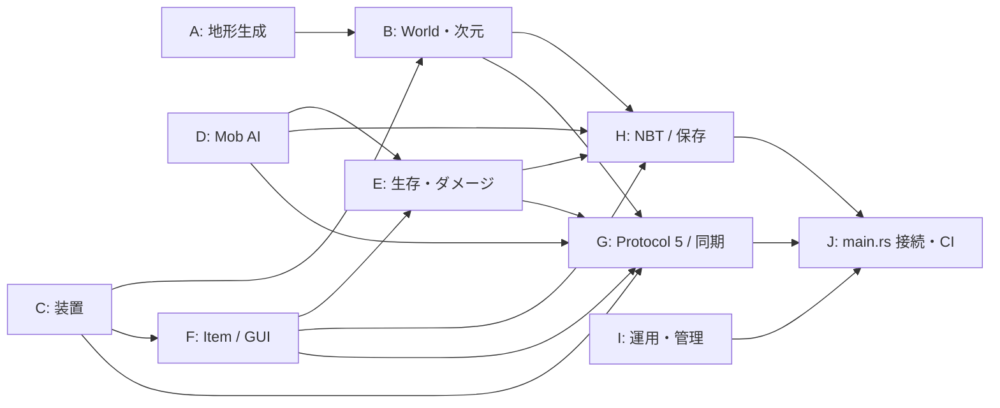

# IndustrialRust1710 AI並列実装バックログ200項目（2026-10-23）

> **性質**: 200件の「実装・精密化・検証」の候補。**200件すべてが未実装であるという意味ではない**。各AIは着手時に最新`main`の実装、open PR、CIと受入結果を確認して「未着手／既存PR／一部実装／要再試験／完了」を更新する。
>
> **対象**: Minecraft Java Edition 1.7.10 / Protocol 5 / Rustネイティブ。本家互換を無改造クライアントで確かめるまでは「完成」と表示しない。

## グループ配置

| AI | グループ | ID | 項目数 | 担当・優先するファイル |
|---|---|---:|---:|---|
| A | 地形・バイオーム・ワールド生成 | 001〜020 | 20 | `worldgen.rs`, `terrain.rs`、生成専用の新モジュール |
| B | ワールド状態・ディメンション・光源 | 021〜040 | 20 | `world.rs`, `dimensions.rs`, `world/lighting.rs` |
| C | ブロック・レッドストーン・装置 | 041〜060 | 20 | `world/devices.rs`, `world/ecology.rs`, `world/special.rs`, `dispensers.rs` |
| D | Mob・AI・Entity・移動物理 | 061〜080 | 20 | `mobs.rs`, `navigation.rs`, `physics.rs`, `vehicles.rs`, `minecarts.rs` |
| E | プレイヤー・戦闘・サバイバル | 081〜100 | 20 | `player.rs`, `survival.rs`, `survival_damage.rs`, `vitals.rs`, `experience.rs`, `achievements.rs` |
| F | アイテム・インベントリ・GUI | 101〜120 | 20 | `items_1710.rs`, `inventory.rs`, `crafting.rs`, `chests.rs`, `furnaces.rs`, `hoppers.rs`, `brewing.rs`、GUI新規モジュール |
| G | 通信・マルチプレイヤー・認証 | 121〜140 | 20 | `crates/legacy-protocol/**`, `multiplayer.rs`, `chunk_pipeline.rs`, `online_auth.rs`, `apps/legacy-status-server/**` |
| H | 保存・Anvil/NBT・データ移行 | 141〜160 | 20 | `legacy_*.rs`, `anvil_*.rs`, `journal.rs`, `level_dat.rs`, `verify_world.rs`, `migration_staging.rs`, `native_tile_export.rs` |
| I | 管理・運用・セキュリティ | 161〜180 | 20 | `admin.rs`, `admin_state.rs`, `server_config.rs`, `whitelist.rs`, `security_limits.rs`, `session_lock.rs`, `backup_world.rs`, `backup_rotation.rs`, `tools/maintenance_supervisor.py` |
| J | 性能・テスト・CI・統合 | 181〜200 | 20 | `telemetry.rs`, `apps/vanilla-server/tests/**`, `crates/legacy-protocol/tests/**`, `.github/workflows/**`、**`main.rs`の唯一の最終接続窓口** |

## 並列作業・統合ルール

1. **1ファイル1書き手**。特に`main.rs`はJ、`world.rs`はB、`worldgen.rs`はA、`world/devices.rs`はC、`mobs.rs`はD、`inventory.rs`はF、`multiplayer.rs`はG、`journal.rs`はH、`server_config.rs`はIが所有。他AIはコールサイトを無断変更せずインターフェース要求をPRへ記す。
2. 各項目は基本**独立PR**にする。`[A-001]`のように担当とIDをタイトルに含め、他の担当ファイルへの変更を禁止する。関連する小項目をまとめる場合も、受入条件は個別に記録する。
3. I/F/E/D/C/Aなどのゲームロジックは「要求・状態遷移・戻り値」を公開し、GがPacket化、Hが永続化、Jが`main.rs`の配線を担当する。共有インターフェースの変更は小さな先行PRとして統合してから並列作業を進める。
4. `main`へのマージは**CI成功、競合なし、既存差分の保存、受け入れ基準の達成**を確認する。main上の実コードを上書きで戻さない。失敗・未検証なら状態を明記。
5. 完了ゲート: `cargo fmt --all -- --check`、`cargo test --workspace --all-targets`、`cargo clippy --workspace --all-targets -- -D warnings`、`cargo build --workspace --release`、該当golden/回帰テスト、必要なら無改造Java 1.7.10実機テスト。保存変更はコピー上の障害復元テストも必須。
6. **PR重複回避**: 計画作成時点のopen PR #189（エンチャント・金床）、#190（Anvil COW）、#191（Mob移動・スポーン）、#176/#171/#141（停止・保守）、#170/#61（Protocol・計測）、#161（天候）等を着手前に照合。完了済み差分を再実装しない。
7. **優先度**: P0＝安全性・保存・通信・主要ゲーム動作・統合阻害、P1＝バニラ互換に必要な機能の拡充、P2＝内容拡充や補助機能。担当20件を同時に編集するのではなく、**担当ごとに非競合PRを順番に作る**。

## 依存図

**図中の矢印は機能依存の向きであり、直接ソースを編集する権限を示さない。**

## 200件一覧

### A. 地形・バイオーム・ワールド生成（001〜020）

担当ファイル: `worldgen.rs`, `terrain.rs`、生成専用の新モジュール

| ID | 優先 | 実装項目 | 完了条件（最低限） |
|---:|:---:|---|---|
| 001 | P0 | シード決定性 | 生成順・再起動を変えてもチャンクハッシュが一致 |
| 002 | P1 | バイオーム気温・降雨テーブル | 1.7.10のID別参照値と境界を固定テスト |
| 003 | P1 | バイオーム境界の平滑化 | チャンク境界に人工的な切れ目が出ない |
| 004 | P1 | 河川の連続性 | 隣接チャンクで流路と水位がつながる |
| 005 | P1 | 海・深海の分布 | シード固定の海洋境界と深さを検証 |
| 006 | P1 | 砂浜・海岸線の形成 | 陸海境界に適切な海岸ブロックが並ぶ |
| 007 | P1 | 丘陵・山岳の高度分布 | バイオームごとの高さヒストグラムを照合 |
| 008 | P1 | 雪原・タイガ・メサの地表 | 表層材質と気候による差異が安定 |
| 009 | P1 | 湿地帯の地形・植生 | 浅瀬と水面・植生の条件が一致 |
| 010 | P1 | 洞窟の分岐と交差 | 固定シードの複数高度で空洞が再現 |
| 011 | P1 | 渓谷生成 | 縦長渓谷が地形と矛盾なく交差 |
| 012 | P1 | 岩盤層の生成 | Y座標ごとの岩盤厚・空洞化禁止を検証 |
| 013 | P1 | 鉱石の高度・鉱脈生成 | 鉱石別の高度・塊数・サイズを測定 |
| 014 | P1 | 地表湖・水たまり生成 | 地形破損なく水面と周辺地盤が整合 |
| 015 | P1 | 地下溶岩湖生成 | 深度と洞窟交差時の材質条件を検証 |
| 016 | P1 | 樹木の樹種・樹形生成 | 幹・葉・樹種ごとの生成結果が一定 |
| 017 | P2 | 花・草・キノコの配置 | 支持ブロックと気候に不適合な配置がない |
| 018 | P1 | ダンジョン・スポナー設置 | 配置・戦利品生成要求をD/Fへ正しく通知 |
| 019 | P1 | 村の地形適合・構造物配置 | 道路・建物が浮遊せず境界で連結 |
| 020 | P2 | 廃坑・要塞の位置生成 | 構造物候補がチャンク生成順に依存しない |

### B. ワールド状態・ディメンション・光源（021〜040）

担当ファイル: `world.rs`, `dimensions.rs`, `world/lighting.rs`

| ID | 優先 | 実装項目 | 完了条件（最低限） |
|---:|:---:|---|---|
| 021 | P0 | Worldライフサイクル分離 | 生成・読み込み・Tick・終了の状態遷移を単体検証 |
| 022 | P0 | 3ディメンションの同時保持 | Overworld/Nether/Endが状態を上書きしない |
| 023 | P0 | ディメンションIDと座標変換 | 移動前後の次元・座標が復元可能 |
| 024 | P1 | ポータル探索の境界検証 | 誤ったブロック構成で転送しない |
| 025 | P1 | ネザーポータル生成・リンク | 8:1座標換算と安全な到着先を検証 |
| 026 | P1 | エンド入場・帰還処理 | 再接続しても帰還状態が失われない |
| 027 | P0 | 次元転送イベント契約 | E/Gのプレイヤー・通信APIへ一意に転送依頼 |
| 028 | P0 | 次元別ワールド状態の永続化 | 再起動後に別次元ブロックを保持 |
| 029 | P0 | ワールド座標の範囲検査 | 境界外変更・オーバーフローを拒否 |
| 030 | P0 | Dirtyチャンク追跡 | 更新チャンクだけを保存対象へ渡す |
| 031 | P1 | チャンク読み込み・解放の責務分離 | 読み込み中の競合・二重登録がない |
| 032 | P1 | ワールドのメモリ保持上限 | 探索を続けても未使用チャンクが際限なく残らない |
| 033 | P0 | 1.7.10ブロックIDとMetadata格納 | 上位ID・負座標・境界値を往復保存 |
| 034 | P1 | 天空光の初期値計算 | 遮蔽・高度による天空光が整合 |
| 035 | P1 | ブロック発光値の伝播 | 光源追加・撤去で周囲の値が収束 |
| 036 | P1 | ブロック変更時の再照明 | 更新対象チャンクを正しく無効化・再配信 |
| 037 | P1 | 天候更新の単独所有 | 雨・雷・降雪が二重に進まない |
| 038 | P1 | 昼夜のワールド時刻 | 20TPS時刻と保存・再開の整合を検証 |
| 039 | P1 | 次元ごとの時刻・天候差 | Nether/Endへ不要な天候処理を流さない |
| 040 | P0 | 次元別再接続・障害復帰 | プレイヤー位置とワールドIDが混同されない |

### C. ブロック・レッドストーン・装置（041〜060）

担当ファイル: `world/devices.rs`, `world/ecology.rs`, `world/special.rs`, `dispensers.rs`

| ID | 優先 | 実装項目 | 完了条件（最低限） |
|---:|:---:|---|---|
| 041 | P0 | レッドストーン粉の信号減衰 | 0〜15強度が線形・分岐回路で正しく収束 |
| 042 | P1 | 配線形状と導体の給電 | 高さ差・不透明ブロック経由の伝播を検証 |
| 043 | P1 | リピーター向きと遅延 | 向き・ロック・設定Tickの信号が整合 |
| 044 | P1 | コンパレーター比較・減算 | F提供のコンテナ量変更を反映 |
| 045 | P1 | ピストン12ブロック押し出し | 押せないブロック・13個超過を拒否 |
| 046 | P1 | 粘着ピストンの引き戻し | 引き戻す対象と例外が一致 |
| 047 | P0 | 移動中ピストンの当たり判定 | 二重ブロック・複製なく配信イベントと整合 |
| 048 | P1 | ディスペンサー9スロット選択 | 入力在庫から一度だけ対象を選択 |
| 049 | P1 | ディスペンサー固有発射効果 | 矢・水/溶岩バケツなど種類別差を検証 |
| 050 | P1 | ドロッパーの排出・転送 | 容器へ移せないとき在庫数が保存される |
| 051 | P1 | ホッパー起動・停止信号 | Cは信号イベント、在庫移動はFへ委譲 |
| 052 | P2 | 音符ブロックの音階と楽器 | 地面材質・ノート値が正しく通知される |
| 053 | P2 | ジュークボックス挿入・排出 | 音楽ディスクが損失せず保存される |
| 054 | P1 | レバー・ボタン・感圧板 | ON/OFFと隣接更新が欠落しない |
| 055 | P1 | 日照センサー出力 | 時間・天候による出力変化を検証 |
| 056 | P1 | トリップワイヤー検出 | 糸・フック・Entity通過を整合 |
| 057 | P1 | TNT着火・連鎖爆発 | 爆発が二重実行されず変更を確定保存 |
| 058 | P0 | 水の流れと水源生成 | 水位・隣接更新が停止時に正しく収束 |
| 059 | P1 | 溶岩の流れと水接触 | 次元差と黒曜石・丸石・石生成を検証 |
| 060 | P1 | 作物・植生の支持と成長 | 成長・破壊・ドロップを再起動後も維持 |

### D. Mob・AI・Entity・移動物理（061〜080）

担当ファイル: `mobs.rs`, `navigation.rs`, `physics.rs`, `vehicles.rs`, `minecarts.rs`

| ID | 優先 | 実装項目 | 完了条件（最低限） |
|---:|:---:|---|---|
| 061 | P0 | スポーン上限のチャンク計算 | 1〜8人でMob分類別上限を超えない |
| 062 | P1 | 明るさ・高度・難易度のスポーン条件 | Peaceful・昼夜・地下の期待結果が一致 |
| 063 | P1 | 群れスポーンの候補選択 | 候補座標が安全で上限を超えない |
| 064 | P1 | デスポーン例外と距離 | ボス・飼育済みMobを通常ルールで消さない |
| 065 | P1 | 障害物に沿う経路探索 | 壁・迂回・到達不能を有界時間内に判定 |
| 066 | P1 | 段差・水泳・壁登りの移動 | 地形別に当たり判定と進行が一致 |
| 067 | P1 | ゾンビの日光・子供・ドア行動 | 環境と難易度で動作を切り替える |
| 068 | P1 | 村人感染・治療イベント | 感染率と治療の状態遷移を保持 |
| 069 | P1 | スケルトンの射線・弓攻撃 | 遮蔽越し発射や過剰連射がない |
| 070 | P1 | クリーパー起爆と爆発半径 | 遮蔽・中断・ブロック破壊を検証 |
| 071 | P1 | クモの昼夜挙動・登壁 | 敵対条件と壁移動を再現 |
| 072 | P1 | 洞窟グモのサイズ・毒 | 当たり判定と状態効果要求が一致 |
| 073 | P1 | 友好Mobの繁殖・成長 | クールダウン・子供・資源が保存される |
| 074 | P2 | 狼・猫などの馴化AI | 所有者・追従・座る状態を永続化 |
| 075 | P1 | 村人の職業・交易状態 | 取引GUI要求をFへ渡し在庫を保持 |
| 076 | P1 | ゴーレムの生成・防衛 | 村・敵対対象・死亡時状態が整合 |
| 077 | P1 | エンダーマンの敵対・テレポート | 安全でない到着先へ転移しない |
| 078 | P1 | スライム・マグマキューブ分裂 | サイズ・分裂ID・ドロップを正確に管理 |
| 079 | P1 | ガスト・ブレイズ・ウィッチ攻撃 | 固有飛翔体・効果をE/GのAPIへ通知 |
| 080 | P1 | ドラゴン・ウィザーの戦闘と持続 | 召喚・討伐・再起動でボスが重複しない |

### E. プレイヤー・戦闘・サバイバル（081〜100）

担当ファイル: `player.rs`, `survival.rs`, `survival_damage.rs`, `vitals.rs`, `experience.rs`, `achievements.rs`

| ID | 優先 | 実装項目 | 完了条件（最低限） |
|---:|:---:|---|---|
| 081 | P0 | HPとダメージ計算の一元化 | 同じ攻撃を二重適用せずHP範囲を守る |
| 082 | P1 | プレイヤーTickの状態更新 | 休止・再接続時にタイマーが暴走しない |
| 083 | P1 | 空腹度・満腹隠し値 | 摂食・消耗の数値を正しく管理 |
| 084 | P1 | ダッシュ・ジャンプの消耗 | 移動種別ごとの空腹消費が一致 |
| 085 | P1 | 自然回復・飢餓ダメージ | 難易度と条件別の回復/損傷を検証 |
| 086 | P1 | ポーション効果の期間管理 | 延長・上書き・期限切れを一度だけ適用 |
| 087 | P1 | 防具・耐性によるダメージ軽減 | Fの装備効果を受けて正しく計算 |
| 088 | P1 | 落下ダメージ・着地判定 | 水・はしご・高所落下の条件を検証 |
| 089 | P1 | 水中呼吸・溺水ダメージ | 呼吸残量と発火条件が一致 |
| 090 | P1 | 炎・溶岩・燃焼継続ダメージ | 着火・水で消火・無敵時間が整合 |
| 091 | P1 | 窒息・サボテン・その他環境ダメージ | 難易度と当たり判定によって正しく減算 |
| 092 | P0 | PvP近接攻撃のサーバー判定 | 射程・攻撃間隔・相手状態を検証 |
| 093 | P1 | 矢・投擲物の被弾解決 | Dの飛翔体IDを一度だけHP処理へ反映 |
| 094 | P1 | 道具と採掘速度の補正 | 道具・水中・空中・効果の所要Tickを検証 |
| 095 | P0 | サバイバル設置・採掘の権威化 | 手持ち数量・地形を偽装して増殖できない |
| 096 | P0 | 死亡時のドロップ・経験値処理 | 死亡地点に一回だけ生成される |
| 097 | P1 | ベッド指定リスポーン | 障害物・別次元・不正ベッドで安全に復帰 |
| 098 | P1 | 複数人睡眠と夜スキップ | 未就寝者がいる場合の時刻処理を検証 |
| 099 | P1 | ゲームモード切替時の状態移行 | Creative/Survivalの状態汚染を防ぐ |
| 100 | P2 | 実績・統計の進行と保存 | 必要条件の一回きり達成と復元を確認 |

### F. アイテム・インベントリ・GUI（101〜120）

担当ファイル: `items_1710.rs`, `inventory.rs`, `crafting.rs`, `chests.rs`, `furnaces.rs`, `hoppers.rs`, `brewing.rs`、GUI新規モジュール

| ID | 優先 | 実装項目 | 完了条件（最低限） |
|---:|:---:|---|---|
| 101 | P0 | アイテムID・Metadataの1.7.10照合 | 既知IDの型とダメージ値が一致 |
| 102 | P0 | スタック上限の定義と検査 | 装備品・一般アイテムの上限を超えない |
| 103 | P0 | ItemStackのNBTラウンドトリップ | 未知タグを消さず読み書きできる |
| 104 | P1 | 耐久値・エンチャント格納 | ダメージと付与情報を保持して再接続可能 |
| 105 | P0 | Window操作の共通トランザクション | 拒否された操作では全スロットが不変 |
| 106 | P0 | 左右クリックの全Window互換 | スタック分割・統合の個数が一致 |
| 107 | P0 | Shiftクリックの移動経路 | コンテナ種別ごとの優先スロットを検証 |
| 108 | P0 | ドラッグによる複数スロット分配 | 奇数個・満杯・異種混在で数が保存 |
| 109 | P0 | ダブルクリック一括回収 | カーソルと全スロットの個数が一致 |
| 110 | P1 | 数字キー・Creative操作の検証 | Survivalで不正なCreative補充を拒否 |
| 111 | P0 | カーソル投棄と例外ロールバック | 切断時もアイテムを複製・消失させない |
| 112 | P1 | 2×2・3×3クラフト共通判定 | スロットの形と配置で結果を再現 |
| 113 | P1 | バニラ1.7.10レシピ網羅 | 材料・Metadataのgolden照合で差分ゼロ |
| 114 | P0 | Shift連続クラフトと容器返却 | ミルクバケツ等の返却と数量が一致 |
| 115 | P0 | 単体・ダブルチェストの同時操作 | 2人操作と再接続で全個数が一致 |
| 116 | P1 | かまど製錬・燃料・経験値 | 1レシピごとの燃料と完了値を検証 |
| 117 | P0 | ホッパー搬入出・自動装置連携 | 循環・詰まりでもアイテムは保存 |
| 118 | P1 | 醸造台とポーション種類 | 材料消費・完成・効果情報を検証 |
| 119 | P1 | エンチャントテーブルGUI | 本棚・候補・XP消費・付与NBTが同期 |
| 120 | P1 | 金床修理・改名GUI | 修理費・合成制約・XPの不足時は変更なし |

### G. 通信・マルチプレイヤー・認証（121〜140）

担当ファイル: `crates/legacy-protocol/**`, `multiplayer.rs`, `chunk_pipeline.rs`, `online_auth.rs`, `apps/legacy-status-server/**`

| ID | 優先 | 実装項目 | 完了条件（最低限） |
|---:|:---:|---|---|
| 121 | P0 | Protocol 5 Status応答の完全化 | サーバー一覧とPingで仕様通りの応答 |
| 122 | P0 | Handshakeの状態遷移と拒否 | 不正な状態順序でPlayに入れない |
| 123 | P0 | パケット長・VarInt境界検査 | 異常長をパニックなく拒否 |
| 124 | P0 | 文字列・Slot・NBTのサイズ制限 | メモリ枯渇や入力切断に耐える |
| 125 | P0 | ログイン時の暗号化シーケンス | RSA/AESの切替後に通信が破綻しない |
| 126 | P0 | 公式セッション照合のFail Closed | 本人確認失敗時にオフラインへ落とさない |
| 127 | P0 | オフラインLAN接続の明示制御 | 意図しない外部バインドが有効にならない |
| 128 | P0 | 名前重複・人数上限・参加条件 | 同名二重登録と上限超過を拒否 |
| 129 | P1 | 接続元単位のレート制限 | 大量接続で既存セッションが枯渇しない |
| 130 | P1 | 1.7.10 Player Infoの同期 | 追加・退出・再接続の一覧が一致 |
| 131 | P1 | Mob/Item/Projectileの生成パケット | Entity種別・Metadataを正確に符号化 |
| 132 | P1 | Entityの視界別配信・解除 | チャンク外に不要Entityを残さない |
| 133 | P0 | Chunk Dataパケットの符号化 | Section/Light/Metadataのbit配置をgolden化 |
| 134 | P1 | チャンク生成・圧縮・送信の有界化 | 低速接続でキューが無限増加しない |
| 135 | P0 | Window Click結果の応答契約 | Fの採否・スロット再送を正しく転送 |
| 136 | P1 | チャットの配信・文字数制限 | 不正UTF・禁止長を拒否し送信順を保持 |
| 137 | P1 | 管理コマンドの通信経路 | Iの権限判定に従い実行結果だけ送信 |
| 138 | P0 | 切断・再接続時のセッション解放 | Entity・登録情報・キューが漏れない |
| 139 | P0 | TCP分割・再送風入力への耐性試験 | 読み取り中断してもフレーム同期を失わない |
| 140 | P1 | 複数プレイヤー間の同期負荷制御 | 1/2/4/8人で送信公平性と上限を測る |

### H. 保存・Anvil/NBT・データ移行（141〜160）

担当ファイル: `legacy_*.rs`, `anvil_*.rs`, `journal.rs`, `level_dat.rs`, `verify_world.rs`, `migration_staging.rs`, `native_tile_export.rs`

| ID | 優先 | 実装項目 | 完了条件（最低限） |
|---:|:---:|---|---|
| 141 | P0 | Anvil Region読込の正確化 | 1.7.10のセクタ配置・圧縮形式を検証 |
| 142 | P0 | Region破損・重複セクタ検出 | 重複・範囲外・切断データを拒否 |
| 143 | P0 | NBT深さ・サイズ・型検査 | 過大・循環相当・不正型入力を拒否 |
| 144 | P0 | 未知NBTタグの保全 | 意味保存できない時は書込拒否 |
| 145 | P0 | SectionのBlocks/Data/Add復元 | 4096ブロックと拡張IDが往復一致 |
| 146 | P0 | TileEntity・EntityのNBT型判定 | 未知型を勝手に削除せず移行可否を返す |
| 147 | P1 | プレイヤーNBTとの相互運用 | UUID・Pos・Inventoryが安全に復元 |
| 148 | P1 | Nether/End用Regionパス | DIM-1/DIM1の保存先を混同しない |
| 149 | P0 | level.dat/level.dat_oldの読込復旧 | 破損時の安全な代替判定を実施 |
| 150 | P0 | ライブChunkStore抽象化 | ワールドロジックと保存形式が分離 |
| 151 | P0 | Anvil Regionのcopy-on-write確定 | session.lock・fsync・renameの安全性を検証 |
| 152 | P0 | Dirtyチャンクのチェックポイント | 更新の重複/取りこぼしを検証 |
| 153 | P0 | 複数ファイルredo transactionの拡張 | 対応操作の変更参加者が全て回復可能 |
| 154 | P0 | ジャーナル破損時のFail Closed | 不完全な記録を推測復旧しない |
| 155 | P0 | 保存途中クラッシュの故障注入 | 各コミット段階のアイテム総数が一致 |
| 156 | P1 | 旧IRW1〜4からの移行 | コピーで変換し元データを不変に保つ |
| 157 | P1 | Anvilへの非破壊エクスポート | 既存フォルダを上書きせず整合チェック |
| 158 | P1 | 外部Anvilの読込ステージング | 未対応NBTがあれば安全に中止 |
| 159 | P0 | ワールド整合性の横断診断 | 読取専用で保存間の不一致を報告 |
| 160 | P1 | 世代アップグレード・ロールバック経路 | 失敗時に旧スナップショットから復旧 |

### I. 管理・運用・セキュリティ（161〜180）

担当ファイル: `admin.rs`, `admin_state.rs`, `server_config.rs`, `whitelist.rs`, `security_limits.rs`, `session_lock.rs`, `backup_world.rs`, `backup_rotation.rs`, `tools/maintenance_supervisor.py`

| ID | 優先 | 実装項目 | 完了条件（最低限） |
|---:|:---:|---|---|
| 161 | P0 | server.propertiesの厳格な解析 | 危険値・未対応値を明示的に検出 |
| 162 | P0 | CLI引数と設定の優先順位 | CLI指定値と設定ファイルの合成が安定 |
| 163 | P0 | 起動前check-configコマンドの整備 | ワールドを書き換えず警告とエラーを返す |
| 164 | P0 | ホワイトリストとops.json整合 | 保存・再起動時の判定が一致 |
| 165 | P1 | プレイヤーBAN・解除の永続化 | BAN中の再接続を拒否 |
| 166 | P1 | IP BANのIPv4/IPv6扱い | 表記揺れ・IPv4-mapped IPv6を検証 |
| 167 | P1 | Kick時の理由通知とクリーン切断 | 離脱後に状態保存と一覧更新が完了 |
| 168 | P0 | 権限管理の境界検証 | 一般ユーザーが管理操作できない |
| 169 | P0 | 公開待受・online-modeの安全既定値 | 誤設定のLAN/WAN公開を拒否・警告 |
| 170 | P0 | /stopの接続整理と停止順 | 接続終了・worker join・保存完了を検証 |
| 171 | P0 | SIGTERM等の停止シーケンス | 同時停止要求でも重複保存が起きない |
| 172 | P1 | バックアップの世代制限・ローテーション | 作成・維持・削除が予定通り行われる |
| 173 | P0 | バックアップ復元テスト | オフラインの一時ディレクトリで読込成功 |
| 174 | P0 | 二重起動防止・world session.lock | 別プロセスが同じワールドを書けない |
| 175 | P1 | 構造化ログと秘密情報の伏せ字 | IP・鍵・トークンの不用意な出力を防ぐ |
| 176 | P1 | 設定と秘密情報のアクセス権 | 権限の緩いファイルを診断時に警告 |
| 177 | P1 | プロセス・セッションの資源上限 | メモリ・接続・リクエスト制限が発動 |
| 178 | P1 | 管理コマンドの入力パーサー | 不正引数・対象不明で副作用が発生しない |
| 179 | P0 | RCON等の外部管理面の既定拒否 | 未実装・非対応の危険な機能を有効化しない |
| 180 | P1 | 導入・更新・障害復旧手順の整備 | 停止・保存・復元の作業を再現可能 |

### J. 性能・テスト・CI・統合（181〜200）

担当ファイル: `telemetry.rs`, `apps/vanilla-server/tests/**`, `crates/legacy-protocol/tests/**`, `.github/workflows/**`、**`main.rs`の唯一の最終接続窓口**

| ID | 優先 | 実装項目 | 完了条件（最低限） |
|---:|:---:|---|---|
| 181 | P0 | Tick処理内訳のトレース | 生成・Mob・物理・保存の所要時間を計測 |
| 182 | P1 | MSPT/TPSの集計統一 | 平均・P95・P99を再現可能に計算 |
| 183 | P1 | CPU・RSS・キュー水位の収集 | 高負荷下のピークと傾向を記録 |
| 184 | P1 | 1/2/4/8人の比較ベンチ | 同条件3回以上で測定値を比較 |
| 185 | P1 | チャンク生成・圧縮ベンチ | 地形差と送信負荷を個別に測定 |
| 186 | P1 | Mob・レッドストーン複合負荷 | 20TPS低下箇所を特定できる |
| 187 | P1 | 長時間Soak試験 | 連続稼働後のメモリ・保存整合を記録 |
| 188 | P0 | Protocol 5 fuzzのCI回帰 | 不正フレームからパニック・ハングしない |
| 189 | P0 | NBT/Region fuzzのCI回帰 | 異常入力で範囲外処理やOOMがない |
| 190 | P0 | 保存障害注入マトリクス | 停止タイミングごとの再起動結果を記録 |
| 191 | P0 | fmt/test/clippyのPR必須ゲート | 失敗した変更がmainに入らない |
| 192 | P1 | テスト分類と並列ジョブ分割 | ユニット・TCP・保存・fuzzを区別 |
| 193 | P1 | Windows/Linuxのrelease build | 両OSの成果物生成を確認 |
| 194 | P1 | 再現ビルドの比較 | 同一入力の成果物差分を検出 |
| 195 | P1 | 成果物SHA256・出所情報 | コミット・ツールチェーン・ハッシュを記録 |
| 196 | P2 | 依存ライセンス・SBOM監査 | 同梱物と第三者ライセンスを照合 |
| 197 | P0 | 無改造Java 1.7.10実機受入手順 | 接続・採掘・GUI・戦闘を記録 |
| 198 | P0 | 2人同時実機・再接続受入 | 状態一致・保存・同期を検証 |
| 199 | P0 | 互換性マトリクスの自動生成 | 機能ごとに実装/未検証/不合格を区別 |
| 200 | P0 | main.rsの変更集約と統合ゲート | 各チームAPIを段階統合しCI・実機試験へ送る |

## 実行フェーズ

- **Wave 0: 重複検査と契約固定** — open PR / main の差分を比較し、共通API・受け入れfixtureを先に定める。
- **Wave 1: P0の安全性・通信・保存** — 基底のWorld / Inventory / Protocol / Anvilの単体機能を担当ごとに並列実装。
- **Wave 2: P1のゲーム機能** — WorldとProtocol APIを固めてから、装置・Mob・GUIなどを並列に拡張。
- **Wave 3: Jによる統合・回帰** — main.rs結線、小PR順次マージ、全CI・無改造実機受け入れ試験。

参考: [図解ガイド](00_プロジェクト図解.md)、[50項目監査](24_50項目実装監査と5人分担_20261021.md)、[100項目バックログ](25_修正すべき点100件_5人分担_20261021.md)。
