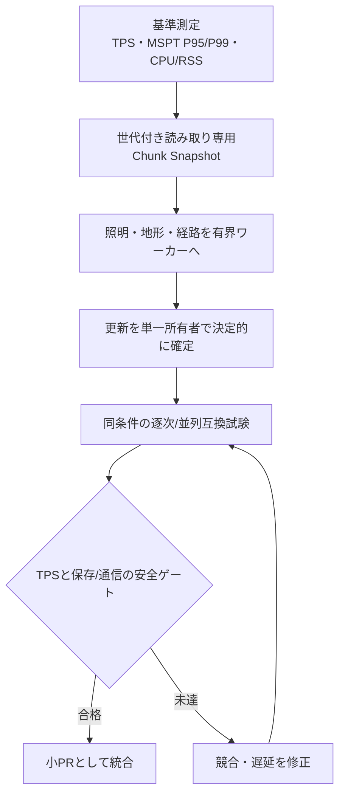

# 並列化・性能最適化の監査（2026-10-23）

> 対象: IndustrialRust1710 / Rustネイティブ / Minecraft 1.7.10。これは**コード経路を確認した改善候補**であり、速度改善の実測報告ではない。実行条件が異なる比較値は「何％高速」として公開しない。

## 今回`main`に統合した改善

| PR | 対象 | 実行した変更 | 確認できる構造的な効果 | 制限 |
|---|---|---|---|---|
| [#204](https://github.com/RyuuzinnRaika/IndustrialRust1710/pull/204) | `world.rs::chunk_data` | IDとMetadataを同一走査で組み立て | 選択セクションあたりブロック状態取得を8,192→4,096回（半減） | 追加メモリ2KiB/選択セクション。照明や地形生成全体の所要時間は未測定 |
| [#205](https://github.com/RyuuzinnRaika/IndustrialRust1710/pull/205) | `navigation.rs::next_step` | A*の候補集合をmin-heap相当にし、スコア・親参照をHashMap化 | 順序付き木の先頭削除・検索をより軽量なデータ構造へ置換 | Mob移動結果と衝突判定のAPIは維持。時間改善率未測定 |
| [#206](https://github.com/RyuuzinnRaika/IndustrialRust1710/pull/206) | `chunk_pipeline.rs` | 固定2ワーカーを利用可能CPUに応じた1〜4ワーカーへ | 1CPU時に1、2CPU時に2、4CPU以上で最大4ジョブを並列zlib圧縮 | 圧縮キュー32件・セッション8件・提出/応答期限は維持。TPSへの影響は実測が必要 |

これら3 PRではfmt、Rustテスト（Protocol 5のTCP試験を含む）、Clippy、ReleaseビルドのCIが成功した。**無改造Minecraft 1.7.10実クライアント試験や、CPU別の性能比較は未実施。**

## 追加で並列化・最適化できる候補（未実装）

| 順位 | 処理 | 現状と並列化できる単位 | 競合・安全上の注意 | 次の受入条件 |
|---|---|---|---|---|
| P0 | チャンク原データ生成 | `main.rs::queue_chunk`で`World::chunk_data`をWorld mutex内で呼ぶ。チャンク単位の読み取り専用スナップショットをワーカへ渡せる余地 | **World全体をチャンクごとにcloneしない**。Worldの書込中に取得した参照をロック外に漏らさない | ワールドロック占有時間、チャンク待機P95、更新直後の見え方を比較 |
| P0 | ライティング再計算 | `world/lighting.rs`の周辺halo計算。編集版を固定したチャンクごとに独立実行可能 | 他チャンクからの発光、編集世代、再送順が必要。古い計算結果を採用しない | 隣接チャンク照明golden一致、無効化世代テスト |
| P1 | Mob経路探索 | `navigation.rs`の個別Mob経路検索。固定World snapshotで複数Mobを並行探索可能 | 衝突・死亡・ブロック変更は決定的な単一適用点へ。読み取り中Worldを変更しない | 同一初期状態の並列/逐次結果一致、128探索上限維持 |
| P1 | 地形生成 | `worldgen.rs`、`terrain.rs`は座標・シードを引数に取る生成処理。チャンクごとに計算分離可能 | ワールドへ取り込む順序を管理。構造物・編集済チャンクの競合を防ぐ | 生成順変更でもバイト一致、負座標/境界テスト |
| P1 | Entity interest管理 | `multiplayer.rs`の可視判定・送信対象抽出を参加者ごとのスナップショットから計算 | `Hub`のロックと送信キューを跨ぐ順序・退出イベントの整合が必須 | 2〜8人で重複Spawnなし、Destroy漏れなし |
| P1 | NBT/Anvil変換 | `legacy_region.rs`周辺の別Regionの読み取り・検査・オフライン変換 | 同一.mcaの並列書込禁止、session.lock / fsync / rename / journalを保持 | 同じ入力から同じ出力・破損注入でFail Closed |
| P1 | Telemetry集計とログ出力 | `telemetry.rs`は定期的にサンプル集計・JSONL追記を実施 | バッファを有界にし、異常時の監査・保存失敗を黙殺しない | Tick側I/O停止時間、サンプル欠落、停止時flush |
| P2 | 独立ディメンションTick | Overworld/Nether/EndのWorld独立所有の設計後のみ検討 | ポータル・転送、複数Worldのロック順とタイムスタンプを定義するまでは並列化しない | 同一Tick入力で逐次・並列の最終状態一致 |

## 実装順

## 測定・合格条件

1. `main`の同一コミット・同じシード・ワールド複製・同じ参加者と操作列を用意し、1 / 2 / 4 / 8人、CPU 1 / 2 / 4程度で各3回以上比較する。
2. `telemetry.rs`の実測MSPT平均・P95・P99、処理TPS、プロセスRSSを収集。チャンク送出時間とWorld mutex待機時間は今後追加計測する。
3. 速くても、所持品・地形・チャンクパケットのgolden、クライアント受信順、再接続/強制終了復元に差があるものは不合格。
4. 過負荷ではジョブの無限蓄積を許さず、既存の有界キュー・期限・切断方針を維持する。ゲーム状態の更新をワーカーが直接競合書込しない。
5. `cargo fmt --all -- --check`、`cargo test --workspace --all-targets`、`cargo clippy --workspace --all-targets -- -D warnings`、`cargo build --workspace --release`、変更機能の回帰、必要な無改造1.7.10実機試験を実施する。

参考: [構成図](00_プロジェクト図解.md)、[AI並列開発200項目](28_AI並列実装200項目_20261023.md)。